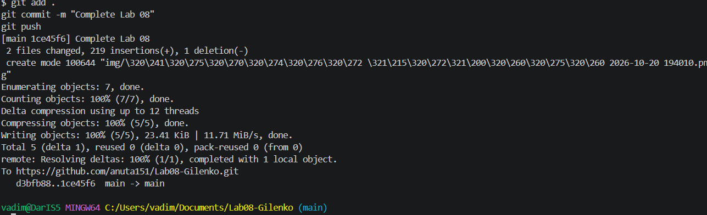

# Практическая работа №8

**ФИО:** Гиленко Анна  
**Группа:** ИСП-241  

## Что изучено

- **`void`-метод** ничего не возвращает — просто выполняет действия (выводит текст, рисует линию). **Метод с `return`** возвращает значение указанного типа, и это значение можно присвоить переменной или передать в другой метод.
- **Параметры** — это входные данные метода. Они объявляются в скобках при объявлении и подставляются при вызове. Метод можно вызвать много раз с разными аргументами — это устраняет дублирование кода.
- **Массивы как параметры** — в метод можно передать массив целиком, и внутри обрабатывать его циклом (`for` или `foreach`). Методы `Average` и `CountGreater` работают с любыми массивами `int[]`.

## Скриншоты

## Ссылка на репозиторий

[Lab08-Gilenko](https://github.com/anuta151/Lab08-Gilenko)